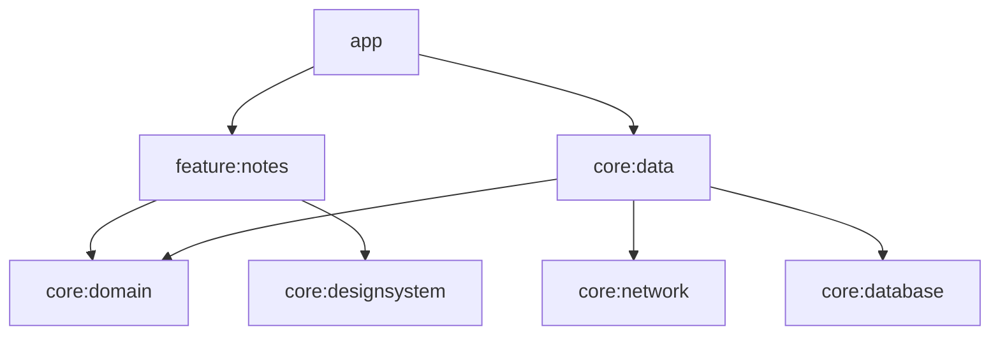

# Architecture: <App>

| Version | Status | Owner | Reviewers |
|---|---|---|---|
| 0.1 | Draft | <tech lead> | <senior Android dev, QA, security> |

## 1. Drivers
| Quality goal (rank) | Scenario | Tactic | NFR |
|---|---|---|---|
| 1. Offline | With no network, opening a saved note takes ≤ 1 s | Room as the source of truth; background sync | NFR-REL-02 |

Constraints: <team, deadline, backend, compliance>

## 2. Stack
The default stack from the android-sdlc skill applies, except for:

| Concern | Choice | ADR |
|---|---|---|
| Module layout | <layer modules / feature + core modules> | ADR-0001 |

## 3. Modules

Layer rules: the skill's rules, plus <project-specific additions>.

## 4. Data and sync
| Repository | Source of truth | Remote | Refresh trigger | Offline writes | Conflict policy | Encrypted |
|---|---|---|---|---|---|---|
| NoteRepository | Room | `GET /v1/notes` | Screen open, pull to refresh | Outbox + WorkManager | Last write wins | No |

- **Room:** <database name, version policy, migration tests>
- **DataStore:** <files and keys>

## 5. API integration
- Base URLs per build type
- Auth and token refresh
- Error mapping
- Pagination
- API versioning
- Minimum supported app version, and how a forced update works

## 6. Navigation
- Top-level destinations
- A graph per feature
- Deep links (verified App Links)
- Back behaviour

## 7. Cross-cutting concerns
| Concern | Decision |
|---|---|
| DI | Hilt; scopes: <…> |
| Error model | `AppError` + `AppResult`; messages mapped in <…> |
| Threading | Injected dispatchers; <…> |
| Logging | Timber; no PII |
| Feature flags / remote config | <tool>; flags: <…> |
| Design system | `core:designsystem`; dynamic color <yes/no> |
| i18n | <locales>; RTL <yes/no> |

## 8. Security
Level: MASVS-<…>

| Asset / entry point | Threat (STRIDE) | Mitigation | MASVS | Req ID |
|---|---|---|---|---|
| Access token | Information disclosure through backups | Keystore-encrypted, excluded from backups | STORAGE | NFR-SEC-01 |
| Deep link `/notes/{id}` | Tampering through a crafted ID | Validate the ID; verified App Links | PLATFORM | NFR-SEC-01 |

## 9. Observability
- Crash and ANR reporting
- Performance traces
- Analytics: the tracking plan (<link>) and consent
- Release dashboard
- Alert owners

## 10. Build, CI/CD and release
- Build types and flavors
- Signing: Play App Signing, with the upload key in CI secrets
- CI stages
- Tracks and staged rollout
- Versioning scheme

## 11. Test strategy
A summary, with a link to [test-plan.md](test-plan.md): test levels, device matrix, environments.

## 12. Risks and technical debt
| ID | Risk or debt | Impact | Mitigation | Owner |
|---|---|---|---|---|
