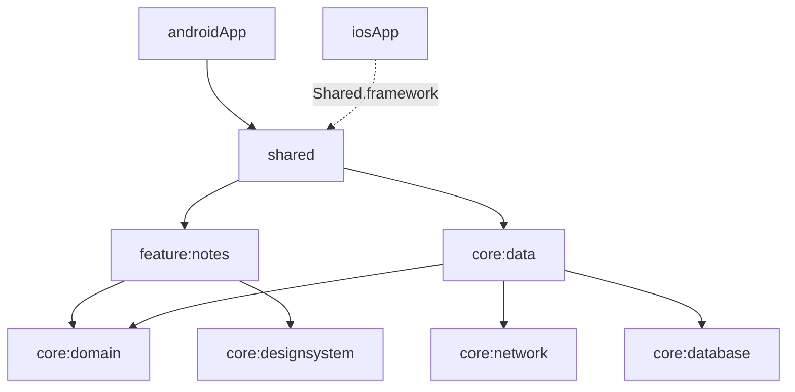

# Architecture: <App>

| Version | Status | Owner | Reviewers |
|---|---|---|---|
| 0.1 | Draft | <tech lead> | <senior Android dev, senior iOS dev, QA, security> |

## 1. Drivers
| Quality goal (rank) | Scenario | Platforms | Tactic | NFR |
|---|---|---|---|---|
| 1. Offline | With no network, opening a saved note takes ≤ 1 s | Both | Room as the source of truth; sync through the `SyncScheduler` | NFR-REL-02 |

Constraints: <team, deadline, backend, compliance>

## 2. Stack
The default stack from the compose-multiplatform-sdlc skill applies, except for:

| Concern | Choice | ADR |
|---|---|---|
| Module layout | <one shared module / feature + core modules> | ADR-0001 |
| iOS integration | <static framework + embedAndSign build phase / SPM / CocoaPods>; SKIE <yes/no> | ADR-0002 |

Toolchain: Kotlin <v> · Compose Multiplatform <v> · AGP <v> · Xcode <v> (compatible per JetBrains' table on YYYY-MM-DD)

## 3. Modules and source sets

Layer rules: the skill's rules, plus <project-specific additions>.

## 4. Platform matrix
Everything not listed here is shared in `commonMain`.

| Capability | Common API | Android implementation | iOS implementation (`iosMain` / Swift) | Why not shared | Tests | Req ID |
|---|---|---|---|---|---|---|
| Secure storage | `SecureStore` | Keystore + Tink + DataStore | Keychain (`iosMain`) | OS key stores | IT-… on each platform | NFR-SEC-01 |
| Background sync | `SyncScheduler` | WorkManager | `BGTaskScheduler` + sync on foreground | OS schedulers | ST-… | NFR-REL-02 |
| Analytics | `AnalyticsTracker` | Firebase Android SDK | Firebase iOS SDK (Swift) | Swift-only SDK | XCTest, IT-… | FR-… |

**Platform look and feel:** <components that adapt to iOS, per ADR-<n>>

## 5. Data and sync
| Repository | Source of truth | Remote | Refresh trigger | Offline writes | iOS background limits | Conflict policy | Encrypted |
|---|---|---|---|---|---|---|---|
| NoteRepository | Room | `GET /v1/notes` | Screen open, pull to refresh | Pending flag + `SyncScheduler` | Sync on foreground; background refresh best effort | Last write wins | No |

- **Room:** <database name, version policy, migration tests>
- **DataStore:** <files and keys>
- **SecureStore:** <keys>

## 6. API integration
- Base URLs per environment, through `AppConfig` (Android build types, iOS `.xcconfig` files)
- Auth and token refresh
- Error mapping
- Pagination
- API versioning
- Minimum supported app version per platform, and how a forced update works on each

## 7. Navigation
- Top-level destinations
- A graph per feature
- Deep links: App Links and Universal Links into the common router
- Back behaviour: system back on Android; a visible back control on every non-root screen for iOS

## 8. Cross-cutting concerns
| Concern | Decision |
|---|---|
| DI | Koin; modules: <…>; started in `Application.onCreate` and the Swift `App` initialiser |
| Error model | `AppError` + `AppResult`; messages mapped to `StringResource`s in <…> |
| Threading | Injected `AppDispatchers`; <…> |
| Logging | Kermit; no PII |
| Feature flags / remote config | <tool>, shared by both apps; flags: <…> |
| Design system | `core:designsystem`; dynamic color on Android <yes/no> |
| i18n | <locales>; RTL <yes/no>; locale-aware formatting through <…>; `CFBundleLocalizations` |

## 9. Security
Level: MASVS-<…>

| Asset / entry point | Platform | Threat (STRIDE) | Mitigation | MASVS | Req ID |
|---|---|---|---|---|---|
| Access token | Both | Information disclosure through backups | `SecureStore` (Keystore / Keychain `ThisDeviceOnly`); excluded from backups | STORAGE | NFR-SEC-01 |
| Deep link `/notes/{id}` | Both | Tampering through a crafted ID | Validated in the common router; App Links / Universal Links | PLATFORM | NFR-SEC-01 |

## 10. Observability
- Crash, ANR and hang reporting; readable Kotlin crashes on iOS through <…>
- Performance traces
- Analytics: the tracking plan (<link>), consent and ATT
- Release dashboard per platform
- Alert owners

## 11. Build, CI/CD and release
- Android build types; iOS configurations and schemes
- Signing: Play App Signing with the upload key in CI secrets; Apple distribution certificate and profiles in CI secrets via <…>
- CI stages: Linux (Android, common tests) and macOS (iOS tests, Xcode builds)
- Versioning scheme shared by both apps
- Release paths: Play tracks with staged rollout; TestFlight and App Store phased release

## 12. Test strategy
A summary, with a link to [test-plan.md](test-plan.md): test levels and source sets, both device matrices, environments.

## 13. Risks and technical debt
| ID | Risk or debt | Platform | Impact | Mitigation | Owner |
|---|---|---|---|---|---|
