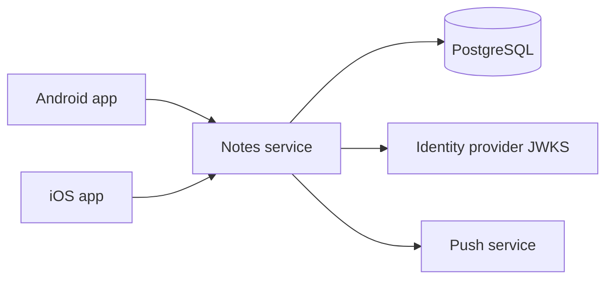
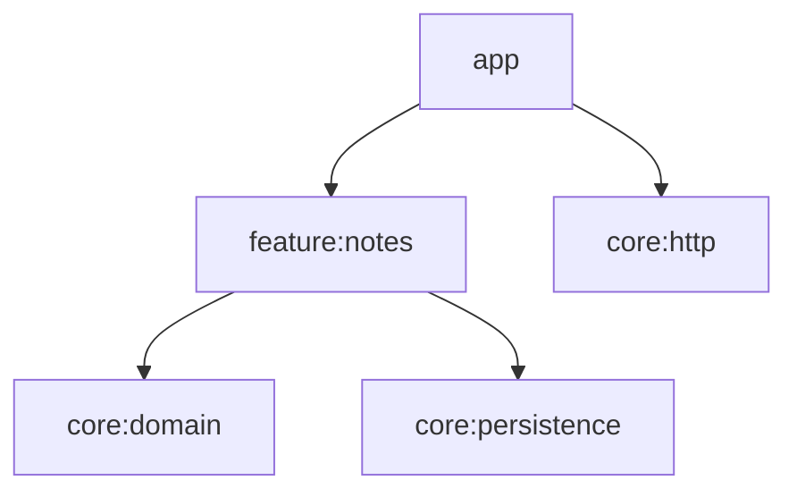

# Architecture: <Service>

| Version | Status | Owner | Reviewers |
|---|---|---|---|
| 0.1 | Draft | <tech lead> | <senior backend dev, client dev, QA, security, operations> |

## 1. Drivers
| Quality goal (rank) | Scenario | Tactic | NFR |
|---|---|---|---|
| 1. Data integrity | A client retries `POST /v1/notes` after a timeout; exactly one note exists | `Idempotency-Key` stored in the same transaction | NFR-REL-02 |
| 2. Latency | At 500 req/s, `GET /v1/notes` answers in ≤ 200 ms at p95 | Keyset pagination; index on `(owner_id, id)` | NFR-PERF-01 |

Constraints: <team, deadline, platform, identity provider, compliance>

## 2. Context

Trust boundaries: <internet → ingress; ingress → service; service → database (private network); service → third parties>

## 3. Stack
The default stack from the ktor-sdlc skill applies, except for:

| Concern | Choice | ADR |
|---|---|---|
| Module layout | <one module / Gradle modules> | ADR-0001 |
| Deployment platform | <…> | ADR-0002 |
| OpenAPI generation from code | <yes (experimental) / hand-written contract only> | ADR-0003 |

Toolchain: Kotlin <v> · Ktor <v> · JDK <v> · Exposed <v> · PostgreSQL <v>

## 4. Modules

Layer rules: the skill's rules, plus <project-specific additions>. Shared contract module with clients: <yes, ADR-<n> / no>.

## 5. API
- Style: REST + JSON; base path `/v1`
- Contract: `docs/api/openapi.yaml`; checked in CI by <tool>
- Versioning and deprecation: <scheme; notice period; how usage per version is tracked>
- Oldest supported client versions: <per consumer>
- Error-code catalogue: <link to the contract section>

## 6. Data stores
| Store | Holds | Why this store | Size and growth | Consistency | Backup and retention |
|---|---|---|---|---|---|
| PostgreSQL <v> | Notes, idempotency keys, outbox | Transactional data | <n> GB, +<n>%/month | Strong, single primary | PITR, <n> days; restore drill quarterly |

- Migrations: Flyway; expand → migrate → contract; a migration job before each rollout
- Caches, queues, object storage: <none / which, and why>

## 7. Authentication and authorisation
- Identity provider: <name>; token: JWT, lifetime <n> min; claims used: `sub`, <roles>, <scopes>, <tenant>
- Service-to-service: <client credentials / mTLS>

| Resource / operation | Anonymous | User | Admin | Object-level rule |
|---|---|---|---|---|
| `GET /v1/notes` | No | Own notes | Own notes | Filtered by owner |
| `GET /v1/notes/{id}` | No | Owner only | Any | Others get 404 |

## 8. Deployment topology
- Platform, regions and zones: <…>
- Environments and their differences: <dev, staging, production; sizes only>
- Replicas <min–max>; autoscaling on <signal>; probes as in the skill's deployment reference
- Ingress / load balancer, TLS termination, WAF: <…>
- Rollout strategy: <rolling / canary / blue-green>; rollback: previous image digest

## 9. Capacity model
| Endpoint / job | Expected req/s | Peak req/s | Queries per request | Notes |
|---|---|---|---|---|

- Bottleneck: <usually the database>; max connections <n>; pool per replica <n>; replicas at peak <n>
- Headroom: <e.g. 2× peak>
- Cost estimate: <per month>

## 10. Reliability
| Dependency | Timeout | Retries | Circuit breaker | If it fails |
|---|---|---|---|---|
| PostgreSQL | Query <n> s; pool wait <n> s | None | — | Readiness fails; 503 |
| Push service | <n> ms | 2, idempotent only | Yes | Push skipped; logged |

- Idempotency: <which endpoints>; outbox: <which events>; scheduled jobs and their locks: <…>

## 11. Cross-cutting concerns
| Concern | Decision |
|---|---|
| Configuration and secrets | `AppConfig`; secrets from <secret manager>; rotation <…> |
| DI | Koin; modules: <…> |
| Error model | `DomainError` → problem+json; codes: <…> |
| Logging | JSON, call ID in MDC; redaction of <…> |
| Feature flags | <tool>; flags: <…> |
| Time, IDs, money | UTC `Instant`; UUID v7; decimal + ISO 4217 |

## 12. Security
Level: ASVS <…>

| Asset / entry point | Threat (STRIDE / API Top 10) | Mitigation | ASVS 5.0 chapter | Req ID |
|---|---|---|---|---|
| `GET /v1/notes/{id}` | Information disclosure: another user's note (API1) | Ownership check in `NoteService`; 404 for others | V8 Authorization | NFR-SEC-01 |
| Access tokens | Spoofing with a forged or foreign token (API2) | JWKS signature, issuer, audience, expiry checks | V9 Self-contained Tokens | NFR-SEC-01 |

## 13. Observability and operations
- SLOs and burn-rate alerts: <…>
- Dashboards: <…>
- Tracing: <agent / library>, sampling <…>
- On-call owner and escalation: <…>
- Runbooks to write before launch: <list>
- DR tier, RPO and RTO: <…>

## 14. Build, CI/CD and release
- CI stages: build, lint, tests with Testcontainers, contract check, image build and scans, migration rehearsal
- Image: <base>, signed, promoted by digest
- Infrastructure as code: <tool, repository>
- Who can deploy to production: <pipeline only, approvals>

## 15. Test strategy
A summary, with a link to [test-plan.md](test-plan.md): test levels, environments, load profiles.

## 16. Risks and technical debt
| ID | Risk or debt | Impact | Mitigation | Owner |
|---|---|---|---|---|
